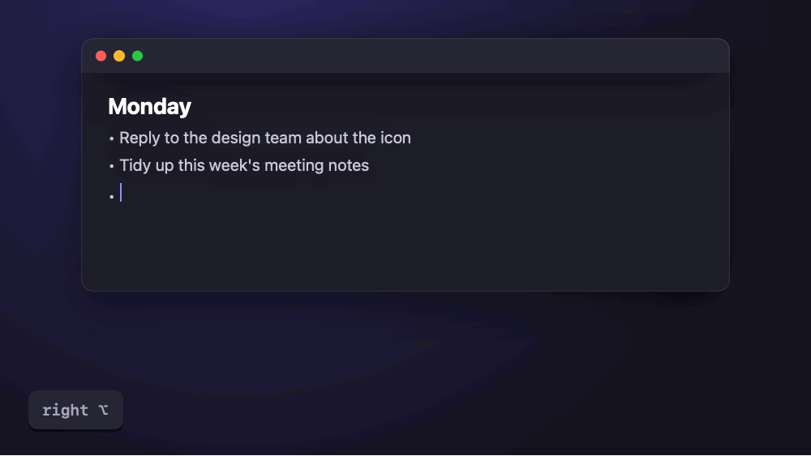
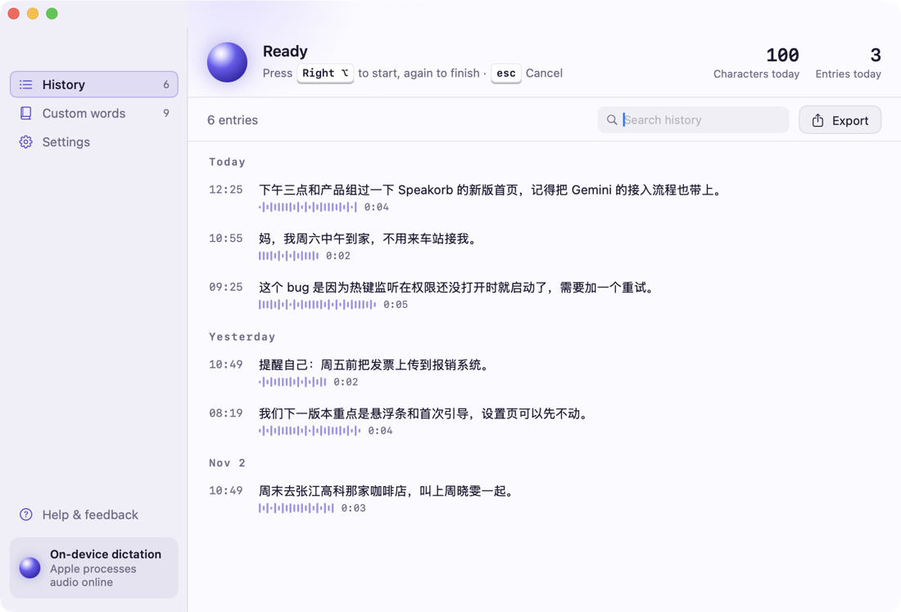
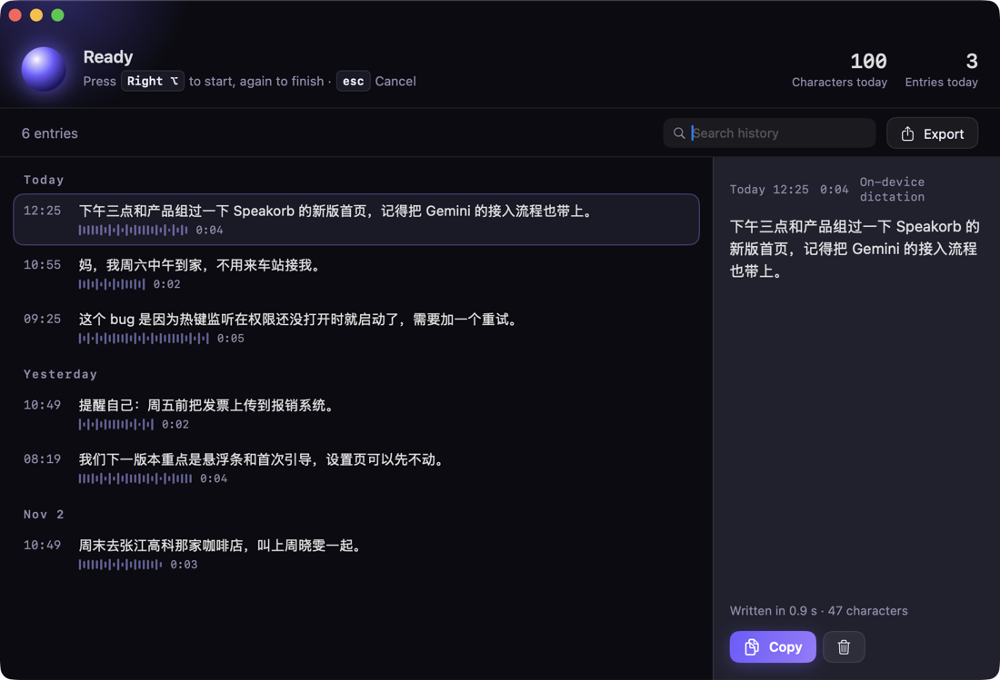
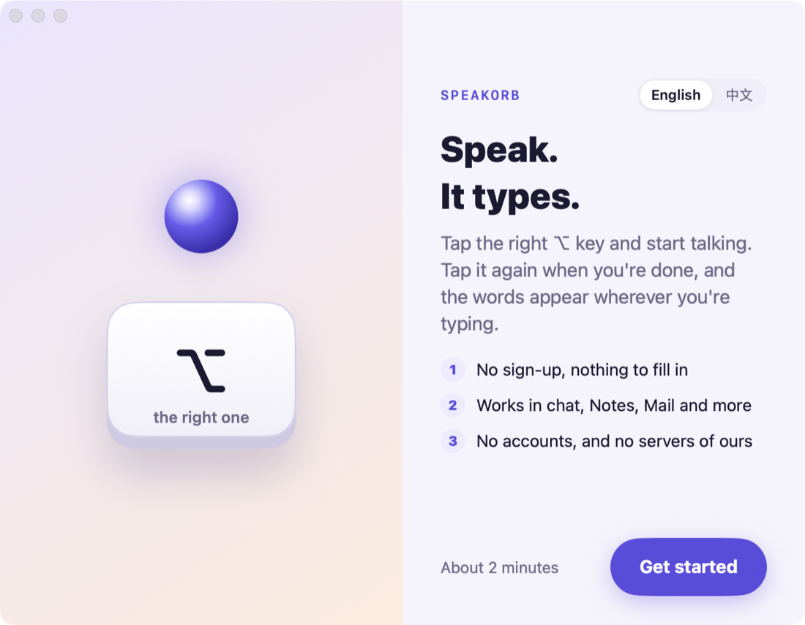
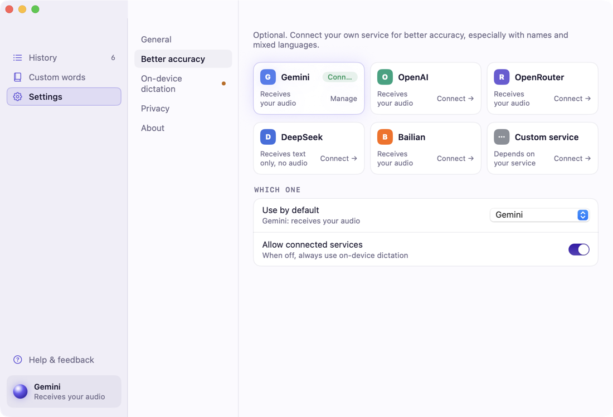
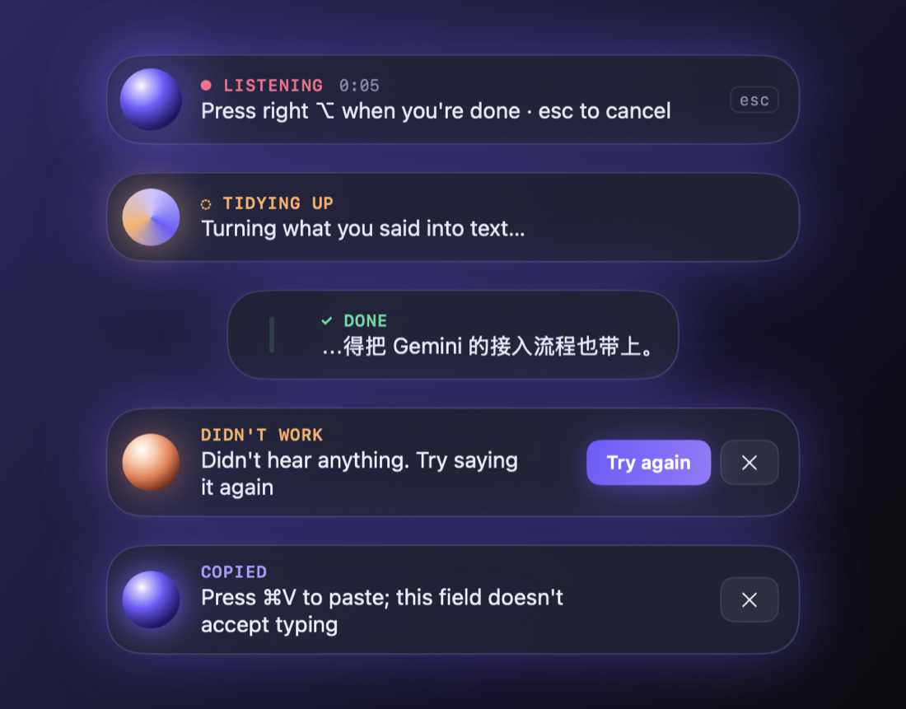

<p align="center">
  
</p>

<h1 align="center">Speakorb · 声球</h1>

<p align="center">
  <b>Finish talking, and the words are there.</b><br>
  Open-source voice typing for macOS. Tap the right ⌥ key, speak, tap it again — the text lands wherever you were typing.<br>
  No sign-up and nothing to fill in. Connect your own Gemini, OpenAI or other service for better accuracy.
</p>

<p align="center">
  <b>English</b> · <a href="README.zh-CN.md">简体中文</a>
</p>

> **This is a 0.1 preview.** It works, but it is early: there is no notarized installer yet, and some features are still on the way (see the [roadmap](#roadmap)). Dictation works in English and Mandarin Chinese.

## What it looks like

| Daylight (default) | Night |
| --- | --- |
|  |  |
|  |  |

<p align="center"></p>

The **orb** is Speakorb's signature. It breathes with your voice while you talk, swirls while it tidies up your words, and shrinks into a text cursor when it's done. You'll see it in the floating bar, the menu bar and the app icon.

## Features

- **Works anywhere you type**: chat apps, Notes, Mail, browsers, documents.
- **One action**: tap right ⌥ to start, tap again to finish, esc to cancel.
- **English or Chinese dictation**: pick the language you speak in Settings → General. In Chinese mode, English words mixed in stay English.
- **A floating bar that never steals focus**: shows the orb and a timer at the bottom of the screen and hides itself 1.2 seconds after the text is in.
- **Works with nothing configured**: uses macOS's built-in dictation by default.
- **Bring your own service for better accuracy**: Google Gemini, OpenAI, OpenRouter, DeepSeek (text only), Alibaba Cloud Bailian, or any OpenAI-compatible endpoint such as Ollama. Keys are stored only in your Mac's Keychain.
- **Custom words**: add names and product terms so they come out right.
- **History**: kept on your Mac, grouped by day, searchable, exportable, deletable.
- **Daylight and Night themes**, or follow the system.
- **English and Chinese interface**: English by default; pick on the first screen or change anytime in Settings → General.

## Where your voice goes

Speakorb has no server, no accounts and collects no usage data. Where audio goes depends on how you dictate:

| Dictation | Where the audio goes |
| --- | --- |
| On-device, offline pack for your language **installed** | Stays on this Mac |
| On-device, offline pack **not installed** | macOS sends it to Apple's online dictation |
| A service you connected (Gemini, OpenAI, OpenRouter, Bailian, custom) | Only to the one you picked |
| DeepSeek | On-device dictation first (audio follows the first two rows), then only the text goes to DeepSeek |

Settings → Privacy in the app shows which one applies to you right now. To install the offline pack: System Settings → Keyboard → Dictation, then add your language. Details: [docs/privacy.md](docs/privacy.md).

## Install

There's no notarized build yet, so please build from source (about two minutes):

```bash
git clone https://github.com/devotexlab/speakorb.git
cd speakorb
./scripts/package.sh
open dist/Speakorb.app
```

Requires macOS 14+ and Xcode 16+.

On first launch Speakorb walks you through four system switches: **Microphone**, **Input Monitoring** (so right ⌥ works as the talk key), **Accessibility** (to put text into the field you're typing in) and **Speech Recognition** (system dictation). Input Monitoring lets the app receive key presses; it only reacts to right ⌥ and esc and ignores everything else. That's one reason it's open source: the code is all here for you to read.

> A self-built app is ad-hoc signed and only runs on the Mac that built it; after rebuilding, macOS may ask you to turn the switches on again.

## Develop

```bash
swift build
swift test
swift run Speakorb
```

| Directory | What's inside |
| --- | --- |
| `Sources/SpeakorbCore` | Pure logic: state machine, routing, prompts and clean-up, custom words, WAV, error copy |
| `Sources/SpeakorbProviders` | Adapters for six services; the network layer is injectable so tests never hit the network |
| `Sources/SpeakorbStorage` | Keychain, SQLite history, settings |
| `Sources/SpeakorbCapture` | Recording and level metering, system dictation, global hotkey, pasting, permissions |
| `Sources/SpeakorbApp` | SwiftUI: floating bar, onboarding, main window, settings, menu bar |
| `Tests/` | Unit tests |
| `bench/` | Protocol and scoring script for a Chinese dictation benchmark (no data collected yet) |

Architecture notes: [docs/architecture.md](docs/architecture.md).

## Roadmap

- [ ] Live text in the floating bar while you speak
- [ ] Show filler words ("嗯", "那个") being struck out while tidying up
- [ ] Better on-device dictation that works offline (Qwen3-ASR)
- [ ] Tell you when a connected service fails and on-device dictation is used instead
- [ ] Choose a different talk key
- [ ] Notarized dmg, Homebrew, auto-update
- [ ] Public Chinese dictation benchmark and results

## Contributing

Issues, ideas and pull requests are welcome — start with [CONTRIBUTING.md](CONTRIBUTING.md). Please report security problems privately as described in [SECURITY.md](SECURITY.md), not in a public issue.

## License

[Apache-2.0](LICENSE). Third-party components: [THIRD-PARTY.md](THIRD-PARTY.md).

The hotkey and paste approach was informed by the open-source [SpeakMore](https://github.com/zephyr4123/speakmore) (MIT). Thank you.
