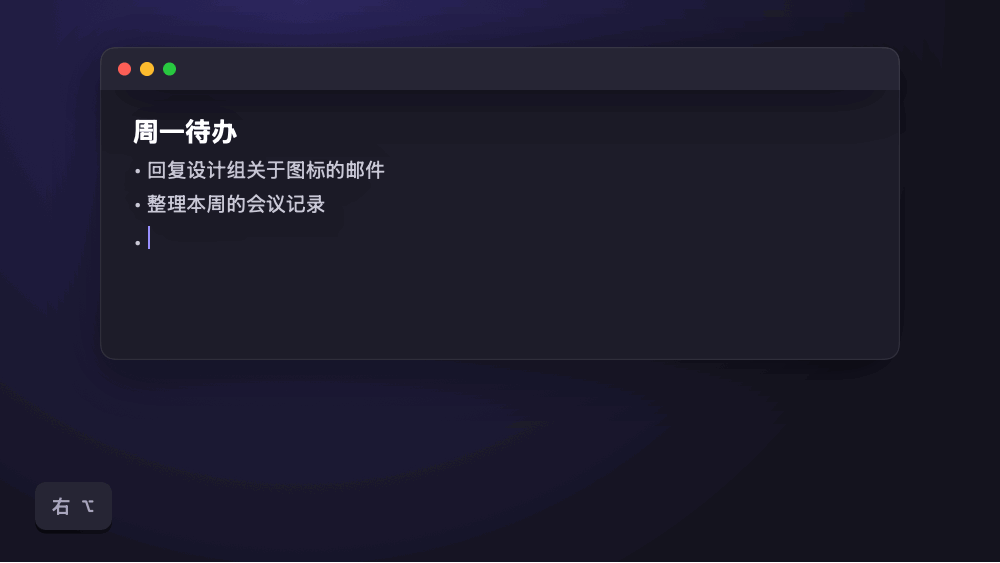
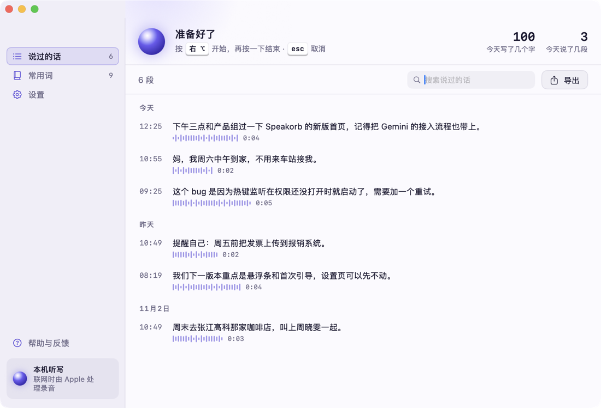
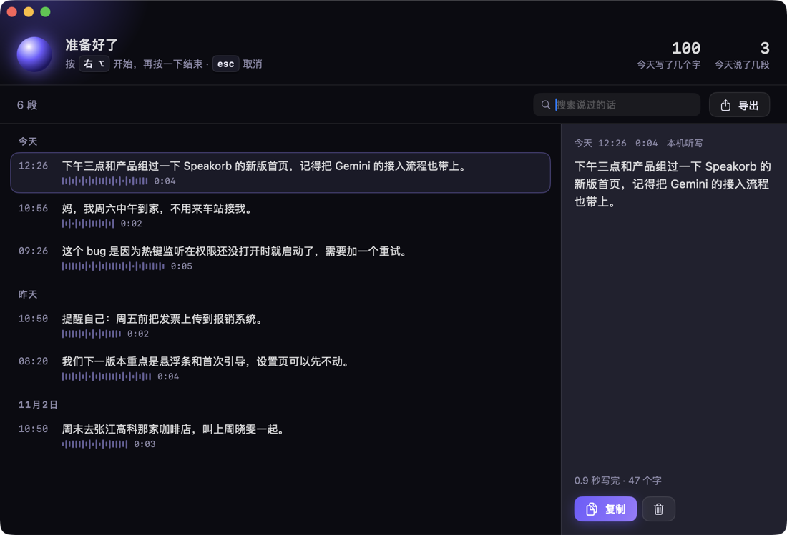
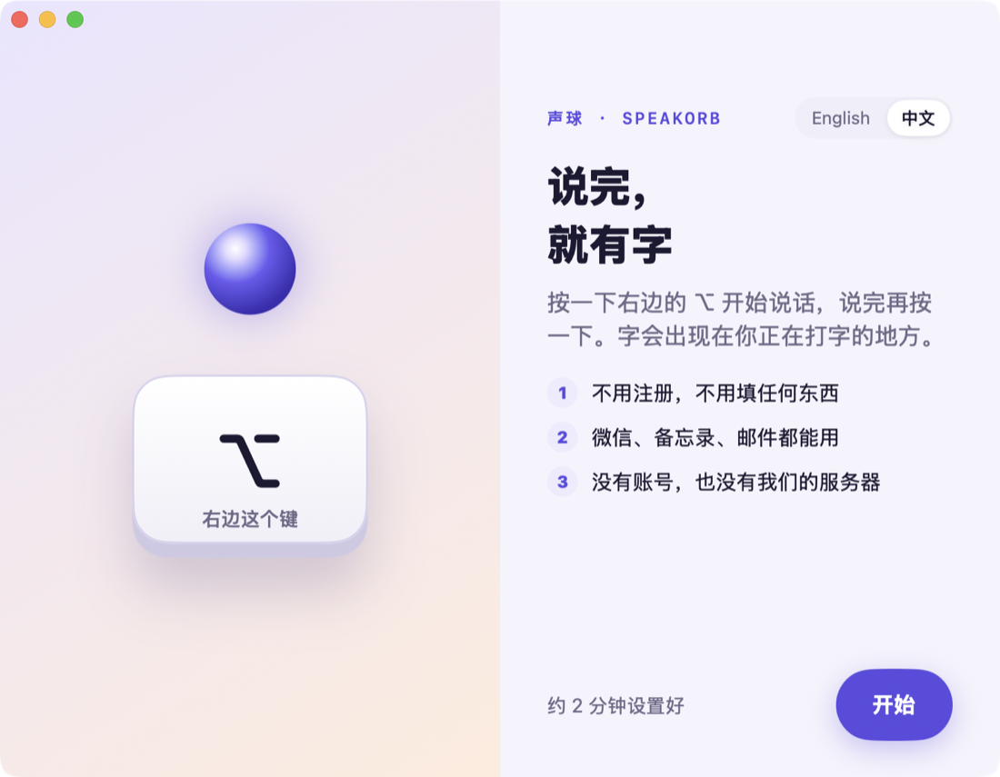
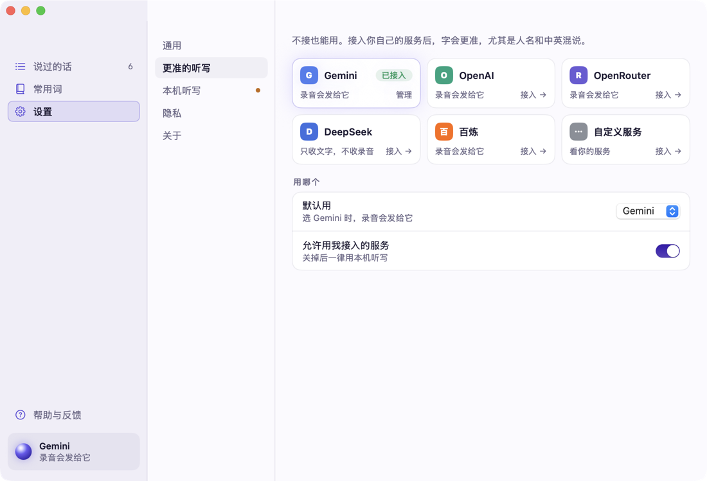

<p align="center">
  
</p>

<h1 align="center">声球 · Speakorb</h1>

<p align="center">
  <b>说完，就有字。</b><br>
  开源的 macOS 语音输入：按一下右边的 ⌥ 说话，再按一下，字就出现在你正在打字的地方。<br>
  不用注册，不填任何东西也能用；接上你自己的 Gemini、OpenAI 等服务会更准。
</p>

<p align="center">
  <a href="README.md">English</a> · <b>简体中文</b>
</p>

> **现在是 0.1 内测版。** 能用，但还很早：没有经过苹果公证的安装包，有些功能还在路上（见[路线图](#路线图)）。欢迎试用和提问题。

## 它长什么样

| 日光（默认） | 夜光 |
| --- | --- |
|  |  |
|  |  |

<p align="center"></p>

**声球**是这个 App 的标志：你说话时它跟着音量呼吸，整理时流光旋转，写好了就缩成一根光标。它出现在悬浮条、菜单栏和图标上。

## 能做什么

- **任何地方都能说**：微信、备忘录、邮件、浏览器、文档……光标在哪，字就放到哪。
- **一个动作**：轻点右 ⌥ 开始，再点一下结束，esc 取消。
- **中文或英文听写**：在「设置 → 通用」选你说哪种话；说中文时夹杂的英文词会保留成英文。
- **不抢焦点的悬浮条**：说话时在屏幕底部显示声球和计时，写好 1.2 秒后自己收起。
- **不填任何东西就能用**：默认用 macOS 自带的系统听写。
- **想更准就接自己的服务**：Google Gemini、OpenAI、OpenRouter、DeepSeek（只收文字）、阿里云百炼，或任何兼容 OpenAI 接口的自建服务（比如 Ollama）。钥匙只存在你 Mac 的钥匙串里。
- **常用词**：把人名、产品名加进去，听写会优先写对。
- **说过的话**：本机保存，按天分组，可以搜索、复制、导出、删除。
- **日光 / 夜光两套主题**，也可以跟随系统。
- **中文和英文界面**：第一屏就能选，之后在「设置 → 通用」随时换。默认英文。

## 你说的话去了哪里

声球没有服务器，没有账号，不收集任何使用数据。录音去哪，取决于你选的听写方式：

| 听写方式 | 录音去哪 |
| --- | --- |
| 本机听写，**装了**你说的语言的离线包 | 不离开这台 Mac |
| 本机听写，**没装**离线包 | macOS 会把录音交给 Apple 的在线听写处理 |
| 接入的服务（Gemini、OpenAI、OpenRouter、百炼、自定义） | 只发给你选的那一家 |
| DeepSeek | 先用本机听写（录音去向同上两行），再只把文字发给 DeepSeek 整理，不发录音 |

App 里「设置 → 隐私」会显示你现在是哪一种。装离线包：系统设置 → 键盘 → 听写，加上你说的语言。详细说明见 [docs/privacy.md](docs/privacy.md)。

## 安装

目前还没有经过苹果公证的安装包，请先从源码构建（大约 2 分钟）：

```bash
git clone https://github.com/devotexlab/speakorb.git
cd speakorb
./scripts/package.sh
open dist/Speakorb.app
```

需要 macOS 14 或更新版本，以及 Xcode 16 或更新版本。

第一次打开会带你打开 4 个系统开关：**麦克风**（听你说话）、**输入监控**（让右 ⌥ 变成说话键）、**辅助功能**（把字放进输入框）、**语音识别**（系统听写）。有了输入监控，声球能收到你的按键，但只对右 ⌥ 和 esc 有反应，其他按键直接忽略。这也是我们开源的原因之一：代码都在这里，可以自己看。

> 自己构建的 App 用的是本机签名，只能在这台 Mac 上用；每次重新构建后，系统可能会让你重新打开开关。

## 从源码开发

```bash
swift build      # 构建
swift test       # 单元测试
swift run Speakorb
```

| 目录 | 内容 |
| --- | --- |
| `Sources/SpeakorbCore` | 纯逻辑：状态机、路由、提示词与后处理、常用词、WAV、错误文案 |
| `Sources/SpeakorbProviders` | 6 家服务的适配器，网络层可注入，测试不发真请求 |
| `Sources/SpeakorbStorage` | 钥匙串、SQLite 记录、设置 |
| `Sources/SpeakorbCapture` | 录音与音量、系统听写、全局热键、贴字、权限 |
| `Sources/SpeakorbApp` | SwiftUI 界面：悬浮条、引导、主窗口、设置、菜单栏 |
| `Tests/` | 单元测试 |
| `bench/` | 中文听写评测的协议与打分脚本（数据还没采集） |

架构说明见 [docs/architecture.md](docs/architecture.md)。

## 路线图

- [ ] 边说边出字：悬浮条实时显示识别中的文字
- [ ] 整理时在悬浮条里划掉“嗯、那个”等口头禅
- [ ] 更好的本机听写：下载一次，断网也准（Qwen3-ASR）
- [ ] 接入的服务出错、换成本机听写时提示你
- [ ] 换说话键
- [ ] 经过苹果公证的 dmg、Homebrew 安装、自动更新
- [ ] 公开的中文听写评测数据与成绩

## 参与

欢迎提问题、提建议、提代码。先看 [CONTRIBUTING.md](CONTRIBUTING.md)。发现安全问题请按 [SECURITY.md](SECURITY.md) 私下报告，不要开公开 issue。

## 许可

[Apache-2.0](LICENSE)。第三方组件见 [THIRD-PARTY.md](THIRD-PARTY.md)。

热键和贴字的做法参考了开源项目 [SpeakMore](https://github.com/zephyr4123/speakmore)（MIT），谢谢。
